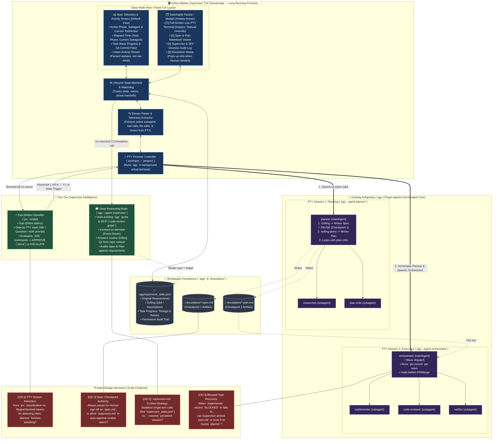

# Antigravity (`agy`) Master Supervisor — High-Level Architecture

## 1. Project Brief & Objective

### The Goal
Build a **Master Supervisor TUI (Terminal User Interface)** that acts as an autonomous proxy for the human developer on top of an existing, Git-tracked Antigravity (`agy`) CLI multi-agent plugin.

The system must take a software development request from initial requirements to a verified, committed development branch with minimal human intervention—autonomously answering routine technical questions, enforcing a strict **Spec $\rightarrow$ Plan** gate, brokering CLI permission prompts (`ctrl+k`), and escalating only genuine product decisions, architectural trade-offs, or high-risk operations to the user.

### The Existing Setup (Baseline Plugin)
The underlying `agy` environment is already packaged as a tracked plugin with a strict two-level hierarchy:
* **Main Agents (`mainAgent: true`):**
  * **`planner`:** Uses `grilling` and `writing-plans` skills. Delegates discovery to `researcher` (read-only) and adversarial review to `plan-critic`. *(Planned upgrade: Split output into a hard **Spec Checkpoint** before running `writing-plans` and `plan-critic`.)*
  * **`orchestrator`:** Uses `subagent-driven-development` and `finishing-a-development-branch`. Delegates implementation waves to `implementer`, review to `code-reviewer`, and test validation to `verifier`. Holds a monopoly on `git commit`.
* **Global Context & Permissions:**
  * Every agent inherits `GEMINI.md`, workspace rules (`config/rules/*.md`), and MCP servers (`code-review-graph`, `context7`, `daas-cd`, `sequential-thinking`, `undermind`).
  * `git commit`, `pytest`, `python`, `uv`, `npm` are allowed for autonomous execution; destructive commands (`rm`, `Remove-Item`) trigger interactive `ASK` (`ctrl+k`) prompts; `.env*` access is hard-blocked (`DENY`). Pull Request creation / merging remains gated.

---

## 2. High-Level System Architecture Diagram



---

## 3. TUI Layout & Telemetry Architecture

Instead of cramming raw terminal output and multiple small panes onto one screen, the TUI uses a **Clean Main Telemetry Screen** with **Hotkey-Switched Panels / Modals**.

### Main Screen (Default View)
Focuses purely on **what is running right now, how long it has been running, and high-level progress** extracted from the background PTY session and Git workspace:

```text
┌──────────────────────────────────────────────────────────────────────────────────────┐
│ 🚀 AGY SUPERVISOR │ Branch: feat/rate-limit │ Total Elapsed: 06m 42s │ Status: 🟢 RUN │
├──────────────────────────────────────────────────────────────────────────────────────┤
│ ⚡ CURRENTLY RUNNING                                                                 │
│   Main Agent : orchestrator (PID 18492)             Phase Elapsed : 04m 15s          │
│   Subagent   : implementer (Wave 2 — Task 3/5)      Task Elapsed  : 01m 12s          │
│   Last Action: edit_file -> src/middleware/limiter.py                                │
│   Last Cmd   : pytest tests/unit/test_limiter.py (Exit 0 — 4 passed)                 │
├──────────────────────────────────────────┬───────────────────────────────────────────┤
│ 📋 PIPELINE & TASK PROGRESS              │ 📡 CLEAN ACTIVITY FEED (Parsed from PTY)  │
│                                          │                                           │
│ [✓] Phase 1A: Spec Approved   (01m 10s)  │ 14:28:10 [ORCH] Dispatched implementer    │
│ [✓] Phase 1B: Plan & Critic   (01m 17s)  │ 14:28:24 [IMPL] Read src/auth/routes.py   │
│ [▶] Phase 2 : Orchestrator    (04m 15s)  │ 14:28:51 [IMPL] Edited limiter.py (+42/-5)│
│     [✓] Task 1: Redis schema  (a1b2c3d)  │ 14:29:05 [IMPL] Ran pytest (4 passed)     │
│     [✓] Task 2: Token bucket  (f4e5d6a)  │ 14:29:18 [JEV]  Auto-approved `rm tmp.db` │
│     [▶] Task 3: Route middleware         │ 14:29:22 [IMPL] Running ruff check...     │
│     [ ] Task 4: Integration tests        │                                           │
│     [ ] Task 5: Code Review & Verify     │                                           │
├──────────────────────────────────────────┴───────────────────────────────────────────┤
│ [1] Main Status  [2] Live PTY Terminal  [3] Spec & Plan  [4] Audit Log  [P] Pause    │
└──────────────────────────────────────────────────────────────────────────────────────┘
```

### What the Python PTY Stream Parser Extracts Automatically
By reading the virtual terminal buffer (`pyte`) and polling lightweight workspace state, the Python controller extracts structured telemetry without needing extra LLM calls:
1. **Active Agent & Subagent Detection:** Matches `invoke_subagent` calls and `SYSTEM_MESSAGE: DONE / BLOCKED` markers in the PTY stream to know exactly which subagent (`researcher`, `plan-critic`, `implementer`, `code-reviewer`, `verifier`) is active.
2. **Execution Timers:** Tracks wall-clock time for the overall run, current lifecycle phase, and active subagent turn (resetting the stall watchdog whenever new bytes arrive from the PTY).
3. **Current Tool / File Touch Tracking:** Parses tool call headers (`edit_file`, `write_to_file`, `run_command`, MCP calls) from the `agy` output stream to show the exact file or command currently being processed.
4. **Git & Workspace Polling:** Watches `git status --short` and `git log -1` after each wave to link completed tasks to actual commit SHAs and changed file counts.

### Switchable Panels & On-Demand Modals
* **`[1]` Main Status Screen:** The clean telemetry view above.
* **`[2]` Live PTY Terminal Panel:** Full-screen interactive view of the underlying `agy` session. You can watch the raw output or press `i` to type directly into `agy` if you want to intervene manually.
* **`[3]` Spec & Plan Reader:** Renders the current `docs/plans/*-spec.md` and `*-plan.md` in a scrollable Markdown viewer.
* **`[4]` Supervisor & `jev` Audit Log:** Detailed table of every grilling question answered by `supervisor.md`, assumptions logged, and `ctrl+k` permissions approved by `jev`.
* **🚨 Auto-Popup Escalation Modal:** Whenever human input is required (a product question during Grilling, Spec sign-off at Checkpoint 1, or a dangerous command), a modal dialog pops up over the screen and rings the terminal bell so you never have to hunt for prompts.

---

## 4. End-to-End Lifecycle & Two-Checkpoint State Machine

This sequence illustrates how the **TUI**, **`jev`**, **`supervisor.md`**, and the **native `agy` agents** interact across the new **Spec Checkpoint** and **Plan Checkpoint**:

```mermaid
stateDiagram-v2
    [*] --> Idle: User enters Requirements in TUI

    state "Phase 1A: Discovery & Spec (PTY #1: planner)" as P1A {
        Idle --> Grilling: Spawn `agy --agent planner`
        Grilling --> ClassifyQuestions: `jev` detects Planner waiting for input
        ClassifyQuestions --> AutoAnswer: Routine / Repo-convention Qs (`supervisor.md`)
        ClassifyQuestions --> HumanEscalate: Product / Security / Ambiguous Qs (TUI Modal Popup)
        AutoAnswer --> Grilling: Inject answers into PTY #1
        HumanEscalate --> Grilling: Inject user answers into PTY #1
        Grilling --> SpecWritten: Planner writes `docs/plans/*-spec.md`
    }

    state "🛑 CHECKPOINT 1: Spec Review" as CP1 {
        SpecWritten --> SpecEvaluation: Supervisor &/or Human reviews `spec.md` [OD-2]
        SpecEvaluation --> Grilling: Revisions requested (injected into PTY #1)
        SpecEvaluation --> SpecApproved: Spec locked in `.agy/supervisor_state.json`
    }

    state "Phase 1B: Task Planning (PTY #1: planner)" as P1B {
        SpecApproved --> WritingPlans: Instruct PTY #1 to run `writing-plans` + `plan-critic`
        WritingPlans --> CriticLoop: Planner <-> `plan-critic` delta checks
        CriticLoop --> PlanReady: `plan-critic` outputs READY (`*-plan.md` written)
    }

    state "🛑 CHECKPOINT 2: Autonomous Plan Audit" as CP2 {
        PlanReady --> PlanAudit: `supervisor.md` verifies `plan.md` matches `spec.md`
        PlanAudit --> WritingPlans: Scope creep or missing requirement detected
        PlanAudit --> PlanApproved: Kill PTY #1 (frees 100% planning context)
    }

    state "Phase 2: Execution & Verification (PTY #2: orchestrator)" as P2 {
        PlanApproved --> WaveDispatch: Spawn `agy --agent orchestrator` with `plan.md`
        WaveDispatch --> PermissionBroker: `jev` monitors PTY #2 stream
        PermissionBroker --> WaveDispatch: Safe `ASK` -> `jev` sends `ctrl+k`
        PermissionBroker --> HumanEscalate2: Risky `ASK` or 3x Task Failure -> Pause & Popup Modal
        HumanEscalate2 --> WaveDispatch: User resolves or overrides in PTY Panel
        WaveDispatch --> BranchVerified: `code-reviewer` + `verifier` pass; final `git commit` done
    }

    BranchVerified --> DeliveryGate: TUI presents Final Report + PR/Merge options
    DeliveryGate --> [*]
```



---

## 5. Open Design Decisions (To Resolve During Build)

| ID | Decision Area | Option A | Option B | Trade-off to Weigh |
| :--- | :--- | :--- | :--- | :--- |
| **OD-1** | **Turn-Completion & Telemetry Parsing in PTY** | **Structured Status Markers:** Instruct `planner` and `orchestrator` (via prompt/skill) to print lightweight lines like `[AGY:PHASE=SPEC_READY]` or `[AGY:TASK=2/5]`. | **Pure Regex + `jev` Parsing:** Parse `agy`'s existing tool-call UI box headers via regex and let `jev` classify pauses. | Adding 2–3 sentinel tags to agent prompts makes the TUI's progress bar and phase detection 100% rock-solid. |
| **OD-2** | **Checkpoint 1 (`spec.md`) Approval Policy** | **Always Human-Gated:** The TUI always pops up the Spec Review modal at Checkpoint 1 and asks the user to click `[Approve Spec]` before `writing-plans` starts. | **Confidence-Based:** `supervisor.md` auto-approves small/unambiguous specs and only pauses for human review if escalated questions occurred. | Always gating the Spec costs 30 seconds of human reading but guarantees `orchestrator` never builds the wrong design. |
| **OD-3** | **`supervisor.md` Invocation Mode** | **Stateless + Ledger Injection:** Every call to `agy --agent supervisor -p "..."` is a fresh one-shot call that reads `.agy/supervisor_state.json`. | **Resumed Session:** Use `agy`'s session resume flag so `supervisor.md` keeps conversational memory across the run. | Stateless + Ledger is immune to context compaction and crashes; Resumed Session avoids re-reading files. |
| **OD-4** | **Handling Mid-Implementation Blockers** | **Escalate Immediately:** If `orchestrator` reports `BLOCKED` or fails verification 3 times on a task, pause PTY #2 and alert the human in TUI. | **Supervisor Triage First:** Wake up `supervisor.md` to inspect the failure diff and give `orchestrator` one tactical hint before bothering the human. | Triage first can resolve simple environment/import hiccups autonomously without waking the user. |
| **OD-5** | **Windows vs. Cross-Platform PTY Backend** | **`pywinpty` (Windows ConPTY native):** Best compatibility with Windows PowerShell/`Get-ChildItem` environments. | **`wexpect` / `pexpect` abstraction:** Unified API if running across WSL/Linux and native Windows. | Depends on whether you run `agy` natively in Windows PowerShell/Terminal or inside WSL2. |