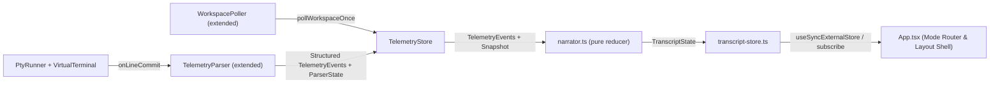

# Design Specification: `agysup` Conversational TUI Redesign & Narration Layer

**Date:** 2026-10-19  
**Source UX Spec:** [`docs/tui-design/agysup TUI UX and UI spec.md`](file:///D:/Code/AntigravityMasterSupervisor/docs/tui-design/agysup%20TUI%20UX%20and%20UI%20spec.md)  
**Status:** Draft — Awaiting Checkpoint 1 Approval

---

## 1. Goal & Problem Statement

The existing TUI in [`src/tui/`](file:///D:/Code/AntigravityMasterSupervisor/src/tui/App.tsx#L26-L290) exposes four module-oriented screens (`MainStatusView`, `LivePtyView`, `SpecPlanView`, `AuditLogView`) navigated via single-letter and digit hotkeys (`1`–`4`, `t`, `i`, `s`, `p`, `q`). This forces the user to piece together what the agent team is doing from a raw activity feed, a ledger, and a terminal viewport, while single-key bindings collide with natural typing.

This redesign replaces the presentation layer in `src/tui/` with a **single conversational supervisor window** backed by a pure **narration layer (`src/tui/narrator.ts`)** and **transcript store (`src/tui/transcript-store.ts`)**, while preserving the existing core and telemetry foundation (`StateLedger`, `PtyRunner`, `VirtualTerminal`, `TelemetryStore`, `TelemetryParser`, `WorkspacePoller`).

### Core Design Principles
1. **Show outcomes, not mechanics:** Never render PIDs, session UUIDs, raw tool names, or ANSI escape sequences in the default view. Translate telemetry into plain-English outcomes (e.g., `"Ran npm test: 14 passed"` instead of `run_command npm test (Exit 0)`).
2. **Interrupt only for decisions:** User interrupts (`ask_question` prompts, `ctrl+k` permission requests, spec review checkpoints, and task blockers/failures) appear inline in the transcript as bordered `DecisionCard` or `FailureCard` items using the single attention color (`ask`).
3. **Never claim what the data cannot back:** Omit test counts, diff line counts, wave totals, or Milestone 3 counters (`QuietCounter`, `Handled for you`) whenever the underlying parser or reasoner has not produced verified data for them.

---

## 2. User Requirements & Resolved Design Decisions

### 2.1 Mandatory User Confirmations (Resolved via Interview)

1. **`/pause` and `/resume` Runtime Behavior:**
   - **Decision:** Implement a **soft-pause controller** in the supervisor TUI/store layer:
     - Entering `/pause` sets `paused: true`, displays `Paused` in the `ask` token in [`HeaderBar.tsx`](file:///D:/Code/AntigravityMasterSupervisor/src/tui/components/HeaderBar.tsx), updates the first [`FooterBar.tsx`](file:///D:/Code/AntigravityMasterSupervisor/src/tui/components/FooterBar.tsx) hint to `/resume`, freezes active elapsed timers in the UI, and holds any outgoing Composer submissions or Decision/Failure card responses in a pending write queue until `/resume`.
     - On POSIX (`process.platform !== 'win32'`), `/pause` additionally sends `SIGSTOP` to the active PTY child process and `/resume` sends `SIGCONT` before flushing queued writes. On Windows (ConPTY), soft-pause manages the queue and timer freeze without unsupported POSIX signals.

2. **`DecisionCard` and `FailureCard` PTY Keystroke Protocol:**
   - **Decision:** Standardize PTY keystroke translation via `onWritePty`:
     - **Numbered `ask_question` menu option $k \in \{1..K\}$:** Sends $(k - 1)$ Down-arrow sequences (`'\x1b[B'.repeat(k - 1)`) followed by Enter (`'\r'`).
     - **Free-form text answer on an `ask_question` menu:** Selects the built-in write-in slot by sending $K$ Down-arrow sequences (`'\x1b[B'.repeat(K)`) + Enter (`'\r'`), followed by `freeformText + '\r'`.
     - **Permission prompt (`ctrl+k`):** Option 1 (`Allow`) sends `'\x0b'` (`Ctrl+K`). Option 2 (`Don't allow`) sends `'\x1b'` (`Esc`).
     - **`FailureCard` options:** Option 1 (`Retry the task`) sends `'Retry the blocked task and resolve the error.\r'`. Option 2 (`Skip it and continue the wave`) sends `'Skip the blocked task and continue with the remaining tasks in the current wave.\r'`. Option 3 (`Take over the terminal`) switches the TUI mode to `'TAKEOVER'`. On a crashed/exited PTY failure card, Option 3 (`Quit`) triggers supervisor shutdown.

3. **First-Launch Empty State & Phase Context Reset:**
   - **Decision:**
     - Keep [`PtyRunner.spawn()`](file:///D:/Code/AntigravityMasterSupervisor/src/pty/runner.ts#L60) running at CLI startup as in [`runCommand`](file:///D:/Code/AntigravityMasterSupervisor/src/cli/commands/run.ts#L93-L148).
     - Initialize the transcript in the **First launch (empty)** state containing only the initial `SupervisorNote` (*"What do you want built? Describe it in your own words. I will ask you only about decisions the repo cannot answer."*) with the `TeamRail` hidden (`hasStarted = false`).
     - Suppress PTY startup banner/boot noise from creating transcript items until either the user submits their first message in the Composer or `TelemetryParser` emits a structured subagent dispatch or interactive decision prompt.
     - When the workspace ledger status transitions from `'PLANNING'` or `'CHECKPOINT_SPEC'` to `'EXECUTING'`, emit the context-reset `SupervisorNote`: *"The plan is approved. I started a fresh orchestrator so it has the full context window. The planning conversation is not carried over."*

### 2.2 Autonomous Engineering Defaults

- **Zoom Mode Keybindings:** Follow Section 7 of the UX spec (`Ctrl+R` toggles full-screen raw output overlay; `Ctrl+T` enters `TAKEOVER` mode) so that all printable characters (`r`, `t`, `1`–`9`, etc.) in `ZOOM` mode route cleanly to the `Composer` without accidental mode switches.
- **Terminal Bell Deduplication:** Track a `Set<string>` of decision card IDs that have already rung `process.stdout.write('\x07')` so re-renders, scroll events, or overlay toggles never ring the bell twice for the same decision.
- **Resize & Scroll Clamping:** Listen to `stdout.on('resize')` via Ink's `useStdout()`. Clamp transcript and zoom scroll offsets on terminal resize or item collapse so the viewport never renders out-of-bounds blank space.
- **Milestone 3 Data Guards:** Keep `QuietCounter` and the `Handled for you` rail section unrendered (`null`) until non-zero verified counts are supplied by the store/narrator, satisfying Rule 3 (*"Never claim what the data cannot back"*).

---

## 3. Architecture & Data Flow



### 3.1 Five Architectural Layers Modified or Added

1. **Extended Telemetry Parsing ([`src/telemetry/parser.ts`](file:///D:/Code/AntigravityMasterSupervisor/src/telemetry/parser.ts#L45-L225)) & Workspace Polling ([`src/telemetry/poller.ts`](file:///D:/Code/AntigravityMasterSupervisor/src/telemetry/poller.ts#L15-L278)):**
   - Extend `TelemetryParser` to emit structured `TelemetryEvent` objects to registered listeners while preserving `getState(): Readonly<ParserState>` backward compatibility for existing unit tests.
   - Extract test runner summaries (Vitest/Jest pass/fail counts), diff line counts (`(+N lines)` when present in tool output), last meaningful error lines (`Error:`, `FAIL`, `ECONNREFUSED`, non-zero exit), structured `ask_question` prompt payloads (question headline + option list), `ctrl+k` command strings, MCP code-graph queries, and per-agent step histories.
   - Extend `parsePlanTasks` in [`src/telemetry/poller.ts`](file:///D:/Code/AntigravityMasterSupervisor/src/telemetry/poller.ts#L15-L99) to parse `## Execution Waves` / `### Wave N` headings (`waveNumber`, `totalWaves`) and per-task markdown checkbox items (`ChecklistItem[]`: `{ text, checked }`).

2. **Pure Narration Reducer (`src/tui/narrator.ts` & `src/tui/narrator-copy.ts`):**
   - `reduceNarrator(state: NarratorState, event: NarratorInputEvent): NarratorState` is a deterministic, side-effect-free state reducer.
   - All human-facing sentence templates, tool-to-verb mappings (`view_file` -> `"reading"`, `write_to_file`/`replace_file_content`/`multi_replace_file_content` -> `"writing"`, `run_command` with `test`/`vitest`/`jest` -> `"running tests"`, `run_command` with `tsc` -> `"running the typecheck"`, `code-review-graph` MCP tools -> `"looking up ... in the code graph"`), and phase notes live in `src/tui/narrator-copy.ts`.

3. **Transcript Store (`src/tui/transcript-store.ts`):**
   - Bridges `TelemetryStore`, `TelemetryParser`, and React (`App.tsx`).
   - Subscribes to `TelemetryParser` line events, `TelemetryStore` snapshot updates (new commits, ledger status changes, task updates, PTY exit), and user actions from the TUI (Composer messages, Decision/Failure card answers, `/pause` & `/resume`, decision deferral).
   - Holds the soft-pause write queue and dispatches queued PTY writes when resumed.

4. **Visual System (`src/tui/theme.ts` & `src/tui/glyphs.ts`):**
   - Centralizes truecolor hex tokens, 16-color ANSI fallbacks (`chalk.level < 3`), light-background detection (`COLORFGBG`), monochrome mode (`NO_COLOR` or `chalk.level === 0`), ASCII glyph fallbacks (`AGYSUP_ASCII=1` or legacy Windows console detection), and motion suppression (`NO_MOTION=1`).

5. **Conversational TUI Components (`src/tui/`):**
   - `App.tsx`: Mode router (`CHAT`, `TEAM`, `ZOOM`, `TAKEOVER`), active overlay state (`null | 'spec' | 'plan' | 'audit' | 'raw' | 'rail-overlay'`), double `Ctrl+C` quit confirmation, soft-pause state, and responsive 80×24 / 110-column breakpoint layout shell.
   - `HeaderBar.tsx`, `FooterBar.tsx`, `Transcript.tsx`, `DelegationCard.tsx`, `DecisionCard.tsx`, `FailureCard.tsx`, `TeamRail.tsx`, `ZoomView.tsx`, `Composer.tsx`, `CommandPalette.tsx`, and `TakeoverView.tsx` (renamed/trimmed from `LivePtyView.tsx`).
   - Retains [`SpecPlanView.tsx`](file:///D:/Code/AntigravityMasterSupervisor/src/tui/components/SpecPlanView.tsx#L14-L105) and [`AuditLogView.tsx`](file:///D:/Code/AntigravityMasterSupervisor/src/tui/components/AuditLogView.tsx#L11-L101) as full-screen body overlays opened via `/spec`, `/plan`, and `/audit`.

---

## 4. Interfaces & Data Contracts

### 4.1 Visual System (`src/tui/theme.ts` & `src/tui/glyphs.ts`)

```typescript
export type ThemeToken = 'text' | 'dim' | 'active' | 'done' | 'ask' | 'line';

export interface ThemeConfig {
  mode: 'truecolor' | 'ansi16' | 'light' | 'monochrome';
  noMotion: boolean;
  colors: Record<ThemeToken, string | undefined>;
}

export interface GlyphSet {
  done: string;        // '✓' or '[x]'
  running: string;     // '▸' or '>'
  paused: string;      // '❚❚' or '||'
  prompt: string;      // '›' or '>'
  treeBranch: string;  // '├' or '|-'
  treeLast: string;    // '└' or '`-'
  spinnerFrames: readonly [string, string, string, string];
}
```

- **Palette Mapping:**
  - `text`: `#D5E2E6` (16-color: `'white'`, light: `undefined` terminal default, monochrome: `undefined`)
  - `dim`: `#84A0AD` (16-color: `'gray'`, light: `'gray'`, monochrome: `undefined`)
  - `active`: `#5CC8C0` (16-color: `'cyan'`, monochrome: `undefined`)
  - `done`: `#8CCB8A` (16-color: `'green'`, monochrome: `undefined`)
  - `ask`: `#FF8FA2` (16-color: `'magentaBright'`, monochrome: `undefined` + `[!] ` prefix on `DecisionCard`/`FailureCard` titles and `inverse` on header badge)
  - `line`: `#2C4A5E` (16-color: `'blue'`, monochrome: `undefined`)
- **Bold Rules:** Bold is permitted only on: (1) `agysup` wordmark in `HeaderBar`, (2) active task title on `DelegationCard`, and (3) headline of `DecisionCard` / `FailureCard`.

### 4.2 Extended Telemetry & Plan Contracts (`src/telemetry/types.ts`)

```typescript
export interface TaskChecklistItem {
  text: string;
  checked: boolean;
}

export interface PlanTaskItem {
  id: string;
  index: number; // 1-based task number in plan
  title: string;
  status: 'pending' | 'in_progress' | 'completed';
  commitSha?: string;
  wave?: number;
  totalWaves?: number;
  checklist?: TaskChecklistItem[];
}

export type AgentStepKind = 'read' | 'write' | 'command' | 'mcp' | 'work';

export interface AgentStepItem {
  id: string;
  timestamp: string;
  agent: string;
  kind: AgentStepKind;
  targets?: string[];         // e.g. ['auth.ts', 'config.ts'] for grouped reads or ['src/middleware/limiter.ts'] for write
  addedLines?: number;        // (+N lines) if known
  command?: string;
  exitCode?: number;
  testSummary?: { passed: number; failed: number };
  mcpQuery?: string;
  status: 'running' | 'ok' | 'failed_recovered' | 'failed';
}

export type TelemetryEvent =
  | { type: 'SUBAGENT_DISPATCHED'; role: string; timestamp: string; rawLine: string }
  | { type: 'TOOL_CALLED'; agent: string; toolName: string; target?: string; addedLines?: number; mcpQuery?: string; timestamp: string }
  | { type: 'COMMAND_STARTED'; agent: string; command: string; timestamp: string }
  | { type: 'COMMAND_FINISHED'; agent: string; command: string; exitCode: number; testSummary?: { passed: number; failed: number }; timestamp: string }
  | { type: 'TEST_SUMMARY'; agent: string; passed: number; failed: number; timestamp: string }
  | { type: 'ERROR_LINE'; agent: string; message: string; timestamp: string }
  | { type: 'SUBAGENT_COMPLETED'; role: string; verdict: 'DONE' | 'DONE_WITH_CONCERNS' | 'NEEDS_CONTEXT' | 'BLOCKED' | 'APPROVE' | 'REQUEST_CHANGES' | 'PASS' | 'FAIL'; reason?: string; elapsedMs: number; timestamp: string }
  | { type: 'DECISION_PROMPT'; promptKind: 'ask_question' | 'permission' | 'checkpoint_spec'; headline: string; question: string; contextLine?: string; command?: string; options: Array<{ index: number; label: string; recommended?: boolean }>; timestamp: string };
```

### 4.3 Transcript & Narrator Contracts (`src/tui/narrator.ts`)

```typescript
export type TranscriptItem =
  | {
      id: string;
      kind: 'UserMessage';
      text: string;
      timestamp: string;
    }
  | {
      id: string;
      kind: 'SupervisorNote';
      text: string;
      timestamp: string;
    }
  | {
      id: string;
      kind: 'PhaseChange';
      text: string;
      phase: string;
      timestamp: string;
    }
  | {
      id: string;
      kind: 'DelegationCard';
      taskId: string;
      taskNumber: number;
      totalTasks?: number;
      title: string;
      wave?: number;
      totalWaves?: number;
      role: string;
      status: 'running' | 'paused' | 'completed' | 'completed_with_concerns';
      nowSentence: string;
      elapsedFormatted: string;
      testSummaryText?: string;
      nextStepText?: string;
      commitSha?: string;
      timestamp: string;
    }
  | {
      id: string;
      kind: 'CommitLine';
      sha: string;
      taskNumber?: number;
      message: string;
      timestamp: string;
    }
  | {
      id: string;
      kind: 'DecisionCard';
      promptKind: 'ask_question' | 'permission' | 'checkpoint_spec';
      headline: string;
      question: string;
      contextLine?: string;
      options: Array<{ index: number; label: string; recommended?: boolean }>;
      status: 'pending' | 'deferred' | 'answered';
      selectedOptionIndex: number; // 1-based default 1 when composer empty
      answeredText?: string;
      timestamp: string;
    }
  | {
      id: string;
      kind: 'QuietCounter';
      promptsApproved: number;
      questionsAnswered?: number;
      planFixes?: number;
      text: string;
    }
  | {
      id: string;
      kind: 'FailureCard';
      taskNumber?: number;
      role: string;
      headline: string;
      reason: string;
      failureKind: 'blocked' | 'needs_context' | 'verify_failed' | 'pty_exit';
      options: Array<{ index: number; label: string; action: 'retry' | 'skip' | 'takeover' | 'quit' }>;
      status: 'pending' | 'resolved';
      selectedOptionIndex: number;
      resolvedText?: string;
      timestamp: string;
    }
  | {
      id: string;
      kind: 'CompletionCard';
      branchName: string;
      taskCount: number;
      commitCount: number;
      verifierResult: string;
      totalElapsedFormatted: string;
      timestamp: string;
    };
```

### 4.4 Interaction Mode & Layout Contracts (`src/tui/App.tsx`)

```typescript
export type TuiInteractionMode = 'CHAT' | 'TEAM' | 'ZOOM' | 'TAKEOVER';
export type TuiOverlayId = null | 'spec' | 'plan' | 'audit' | 'raw';

export interface TeamMemberRow {
  id: string;
  role: string;
  isMain: boolean;
  taskNumber?: number;
  statusText: string; // 'running' | 'waiting' | 'idle' | 'approved' | 'after Task N' | 'paused' | 'paused, needs you'
  elapsedFormatted?: string;
  needsYou: boolean;
}
```

- **Sizing & Responsive Layout Rules:**
  - Minimum supported terminal dimensions: `columns >= 80 && rows >= 24`. Below 80×24, render a single line: `"Make this window at least 80 columns by 24 rows."`
  - At `columns >= 110`: Render `Transcript` (or `ZoomView`) on the left (`flexGrow={1}`, text column capped at `76` columns with hanging indent: `12`-column speaker label box + `flexGrow` body box) and `TeamRail` on the right (`width={32}`).
  - At `80 <= columns < 110`: Hide `TeamRail` by default. Pressing `Tab` toggles `TeamRail` as a right-hand overlay (`width={32}`) and enters `'TEAM'` mode. Pressing `Enter` on an agent in the overlay enters `'ZOOM'` mode and closes the overlay so `ZoomView` gets the full width; pressing `Tab` inside `'ZOOM'` below 110 columns toggles the rail overlay back on.
  - Parallel running tasks in one wave: show at most `3` live `DelegationCard` boxes in `Transcript`; collapse additional active tasks into a single dim line `"+N more running"` (selecting/opening Team mode shows all).
  - Pending decisions queue: Only the oldest pending `DecisionCard` or `FailureCard` is expanded and focused; newer pending decisions render as a 1-line stub `"+N more waiting"`.

- **Slash Commands & CommandPalette (`src/tui/components/CommandPalette.tsx`):**
  - Typing `/` at the start of the `Composer` opens a compact autocomplete list above the composer matching:
    - `/spec` — Opens full-screen `SpecPlanView` (`activeDoc="spec"`). `Esc` closes.
    - `/plan` — Opens full-screen `SpecPlanView` (`activeDoc="plan"`). `Esc` closes.
    - `/audit` — Opens full-screen `AuditLogView`. `Esc` closes.
    - `/raw` — Enters `'TAKEOVER'` mode (or full raw output in Zoom).
    - `/pause` and `/resume` — Toggles soft-pause state.
    - `/decide` — Jumps transcript scroll offset to `0` and re-focuses the oldest deferred `DecisionCard` / `FailureCard`.
    - `/help` — Appends a `SupervisorNote` listing keyboard shortcuts and slash commands in the transcript.
    - `/quit` — Triggers graceful supervisor shutdown (same as confirmed double `Ctrl+C`).

---

## 5. Error Handling & Fallback Rules

1. **Missing Reason on `BLOCKED` / `NEEDS_CONTEXT`:**
   - If `TelemetryParser` has recorded a recent error line (`lastErrorLine`), quote it in the `FailureCard`.
   - Otherwise, render the exact fallback sentence from Section 5.3: `"The <role> reported it is blocked and did not say why. Open the agent to read its last output."`
2. **Non-Zero PTY Exit / Process Crash:**
   - When `PtyRunner` emits `exit` with `exitCode !== 0` (and not triggered by user quit), append a `FailureCard` (`failureKind: 'pty_exit'`) displaying the exit code and last error line with options: `1 Retry the task`, `2 Take over the terminal`, `3 Quit`.
3. **Unparsed Wave Numbers, Test Counts, or Diff Sizes:**
   - If `WorkspacePoller` finds no wave headings in the active plan markdown, `DelegationCard` right-aligns `task N of M` instead of `wave N of M`.
   - If no Vitest/Jest summary line has been parsed for the active task, omit Line 3 (`14 of 14 tests pass so far.`) from `DelegationCard`.
   - If line diff count (`+N lines`) is not present in the tool output, `ZoomView` renders `"Wrote <path>"` without a parenthetical count.
4. **Subagent Stream Isolation in `ZoomView`:**
   - `TelemetryParser` records per-agent steps between a subagent's dispatch marker and completion marker. If the user zooms into `orchestrator` or a subagent whose segment boundaries were not isolated, `ZoomView` displays the main agent's recent steps and states so in the summary card header.
5. **Double `Ctrl+C` Confirmation:**
   - Pressing `Ctrl+C` once in `CHAT`, `TEAM`, or `ZOOM` sets a pending quit confirmation flag and changes the `FooterBar` text to `"Stop the team and quit? Press Ctrl+C again."` Any other keystroke cancels the confirmation; a second `Ctrl+C` within the confirmation state invokes `onRequestQuit()`.

---

## 6. Explicit Out-of-Scope Items

- **Milestone 3 LLM Supervisor Reasoner:** Automated repo-grounded interview answering and LLM-generated supervisor prose are out of scope for this milestone; supervisor notes use deterministic templates in `src/tui/narrator-copy.ts`.
- **`jev` Permission Risk Classifier:** Auto-approval classification of `ctrl+k` prompts is out of scope; until `jev` is integrated, all parsed `ctrl+k` permission prompts surface as `DecisionCard` interrupts, and `QuietCounter` / `Handled for you` remain hidden when their counts are `0`.
- **Multi-PTY Process Respawn Engine:** Modifying `src/cli/commands/run.ts` to tear down and respawn separate OS processes between planning and execution is out of scope; the TUI narrates phase transitions based on `StateLedger` and `TelemetryStore` signals.

---

## 7. Acceptance Criteria

1. Launching with no arguments renders the empty chat with the initial supervisor prompt and focused composer (`"Describe what you want built"`), hiding the Team rail until the first agent starts.
2. During execution, the default view shows the active `DelegationCard`, completed `CommitLine` / collapsed task lines, and `TeamRail` without pressing any key.
3. No default view ever displays a PID, session UUID, raw tool call identifier, or raw ANSI sequence.
4. An `ask_question` prompt or `ctrl+k` permission prompt produces one `DecisionCard`, rings the terminal bell (`\x07`) once, and shows the `1 needs you` header badge; answering collapses the card to `"You chose: ..."` and clears the badge.
5. Typing `q`, `p`, `t`, `r`, or digits `1`–`4` in `CHAT` mode (when no `DecisionCard` is focused) inserts those characters into the `Composer` without triggering mode switches or quitting.
6. The `ask` color token (`#FF8FA2` / `magentaBright`) is applied exclusively to elements waiting on the user (`DecisionCard`, `FailureCard`, `1 needs you` badge, `Paused` badge, `needs you` rail status, and the `TakeoverView` banner).
7. Resizing the terminal from 120 to 80 columns hides the `TeamRail` (accessible via `Tab` overlay) without losing transcript content; resizing below 80×24 displays the single-line minimum-size warning.
8. Setting `NO_COLOR=1`, `AGYSUP_ASCII=1`, or `NO_MOTION=1` produces a clean, readable screen with appropriate monochrome/ASCII/static fallbacks.
9. Unit tests in `tests/` cover every row of the Section 5 event-to-item mapping table in `narrator.ts`, responsive layout snapshots at 80×24 and 120×36, and `npx tsc --noEmit` passes with zero errors.
